<a href="https://rexxar.xyz"></a>

<p align="center">
  <a href="https://rexxar.xyz"><b>rexxar.xyz</b></a> &nbsp;·&nbsp;
  <a href="https://www.linkedin.com/in/egor-suslin-data-science">LinkedIn</a> &nbsp;·&nbsp;
  <a href="mailto:riharex420@gmail.com">riharex420@gmail.com</a>
</p>

I build LLM applications and AI agents and take them all the way to production: architecture, backend, frontend, CI/CD, security, and the risk assessments a regulated company asks for before go-live. 8 years of Python, AI since 2021, across insurance, pharma, banking and energy.

Most of that work is private or under NDA, so what you see here is forks and experiments. The case studies, with animated architecture diagrams, are on [rexxar.xyz](https://rexxar.xyz/#cases).

### What I build

- **Agentic AI**: multi-agent workflows, tool calling, MCP, and identity, policy and audit layers for AI agents that make payments
- **RAG and document AI**, including medical document analysis
- **Voice AI**: speech-to-text, text-to-speech and live translation for customer support
- **AI security and compliance**: guardrails, access control, the EU AI Act, security and risk assessments
- **Production**: Kubernetes, Terraform, Docker and CI/CD on Azure, Google Cloud and DigitalOcean

### Stack

```text
lang    python · typescript · go · rust · sql
ai      langgraph · langchain · mcp · rag · evals
models  azure openai · vertex ai · claude · gemini · ollama · whisper
web     fastapi · react · next.js · node.js · astro
infra   kubernetes · terraform · docker · nginx · ci/cd · azure · gcp · digitalocean
data    postgresql · mongodb · redis
```

<sub>The portrait is plain ASCII: each character is picked by shape from a photo and a depth map. On <a href="https://rexxar.xyz">rexxar.xyz</a> it runs live and follows your cursor.</sub>
