<a href="https://rexxar.xyz"></a>

<p align="center">
  <a href="https://rexxar.xyz"><b>rexxar.xyz</b></a> &nbsp;·&nbsp;
  <a href="https://www.linkedin.com/in/egor-suslin-data-science">LinkedIn</a> &nbsp;·&nbsp;
  <a href="mailto:riharex420@gmail.com">riharex420@gmail.com</a>
</p>

I build LLM applications and AI agents and take them all the way to production: architecture, backend, frontend, CI/CD, security, and the risk assessments a regulated company asks for before go-live. 8 years of Python, AI since 2021, across insurance, pharma, banking and energy.

Most of that work is private or under NDA, so what you see here is forks and experiments. The case studies are on [rexxar.xyz](https://rexxar.xyz/#cases).

### What I build

<p align="center">
  <a href="https://rexxar.xyz/#build"></a>
  <a href="https://rexxar.xyz/#build"></a>
  <a href="https://rexxar.xyz/#build"></a>
</p>
<p align="center">
  <a href="https://rexxar.xyz/#build"></a>
  <a href="https://rexxar.xyz/#build"></a>
</p>

- **Agentic AI**: multi-agent workflows, tool calling, MCP, and identity, policy and audit layers for AI agents that make payments
- **RAG and document AI**, including medical document analysis
- **Voice AI**: speech-to-text, text-to-speech and live translation for customer support
- **AI security and compliance**: guardrails, access control, the EU AI Act, security and risk assessments
- **Production**: Kubernetes, Terraform, Docker and CI/CD on Azure, Google Cloud and DigitalOcean

### Case study: a control plane for AI agents that spend money

<a href="https://rexxar.xyz/#cases"></a>

Agents carry a verifiable identity, and a policy engine checks budgets and allow lists before anything executes. Payments over a threshold wait for a person, and one audit ledger covers card and crypto, with an EU AI Act export. [More case studies](https://rexxar.xyz/#cases).

### Stack

```text
lang    python · typescript · go · rust · sql
ai      langgraph · langchain · mcp · rag · evals
models  azure openai · vertex ai · claude · gemini · ollama · whisper
web     fastapi · react · next.js · node.js · astro
infra   kubernetes · terraform · docker · nginx · ci/cd · azure · gcp · digitalocean
data    postgresql · mongodb · redis
```

<sub>Everything above is plain ASCII. The portrait's characters are picked by shape from a photo and a depth map, with the oni mask painted on before the conversion; the tiles and the diagram are recorded from the engines behind <a href="https://rexxar.xyz">rexxar.xyz</a>, where they run live.</sub>
